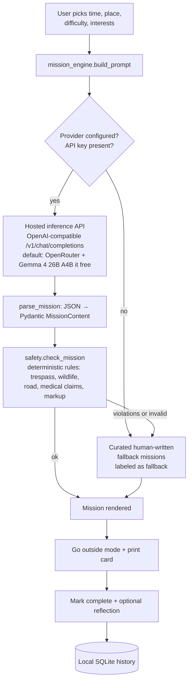

# OutsideQuest AI

**Less scrolling. More exploring.** A Streamlit app that turns your free time into a
personalized outdoor mission — generated by an open-weight model
([Gemma 4](https://ai.google.dev/gemma) via a hosted inference API you configure),
checked by a deterministic safety layer, and labeled honestly when the model isn't
reachable.

Built for the [Hacktoberfest 2026 Week 1 DEV Challenge: "Touch Grass"](https://dev.to/challenges/hacktoberfest-week1-2026-10-05).

<!-- ## Screenshots -->
<!-- 
| Quest builder | Mission card |
| --- | --- |
|  |  |

| Outside mode | History |
| --- | --- |
|  |  |

| AI-generated mission | History (AI source) |
| --- | --- |
|  |  | -->

## How it works



Design rules:

- **Open-weight model only.** Default is `google/gemma-4-26b-a4b-it:free` on OpenRouter
  (Apache 2.0). Any OpenAI-compatible endpoint works via `OUTSIDEQUEST_PROVIDER=openai_compatible`.
- **No key → curated fallback.** Missions written by the project authors, shown with a
  "written by humans, not AI" badge. Never pretend a fallback was generated.
- **Deterministic safety gate.** Model output is parsed into Pydantic models and run
  through regex rules (trespass, wildlife handling, road behavior, medical claims,
  HTML/JS markup). Violations fall back to the curated set. Safety notes are required
  to mention traffic/road context.
- **Nothing executes.** Model output is never rendered as HTML or executed — plain
  text only, via Streamlit's safe text rendering.
- **Privacy.** AI requests send only your quest settings (time, place type, difficulty,
  interests). History lives in a local SQLite file. No GPS, no accounts, no telemetry.

## Setup (Windows / PowerShell)

```powershell
# 1. Clone and enter the project
cd outsidequest-ai

# 2. Create a virtual environment (Python 3.11+)
python -m venv .venv
.\.venv\Scripts\Activate.ps1
# or with uv: uv venv --python 3.12; uv pip install -r requirements.txt

# 3. Install dependencies
pip install -r requirements.txt

# 4. Configure your API key (optional — fallback works without it)
Copy-Item .env.example .env
notepad .env   # paste your key into OPENROUTER_API_KEY

# 5. Run the app
streamlit run app.py
```

macOS / Linux:

```bash
cd outsidequest-ai
python3 -m venv .venv && source .venv/bin/activate
pip install -r requirements.txt
cp .env.example .env   # add your key
streamlit run app.py
```

### Getting an API key (optional)

| Provider | Key | Notes |
| --- | --- | --- |
| OpenRouter (default) | <https://openrouter.ai/settings/keys> | Free-tier model `google/gemma-4-26b-a4b-it:free`; ~50 requests/day without credits |
| Hugging Face | <https://huggingface.co/settings/tokens> | Set `OUTSIDEQUEST_PROVIDER=huggingface`, `OUTSIDEQUEST_MODEL=google/gemma-4-26B-A4B-it` |
| Any OpenAI-compatible gateway | your endpoint + key | Set `OUTSIDEQUEST_PROVIDER=openai_compatible`, `OUTSIDEQUEST_BASE_URL`, `OUTSIDEQUEST_MODEL` |

Without a key, the app is fully usable — you get the curated fallback mission set,
clearly labeled.

## Configuration

All settings are environment variables (or `.env`, loaded via python-dotenv).
See [`.env.example`](.env.example) for the full annotated list:
`OUTSIDEQUEST_PROVIDER`, `OUTSIDEQUEST_MODEL`, `OUTSIDEQUEST_BASE_URL`,
`OUTSIDEQUEST_API_KEY` / `OUTSIDEQUEST_API_KEY_ENV`, timeout/retry/token/temperature
tunables, and `OUTSIDEQUEST_DB_PATH`.

## Tests & lint

```powershell
pytest -q          # 54 tests: parsing, safety rules, fallbacks, providers, storage
ruff check .       # lint
```

## Project layout

```
outsidequest-ai/
├── app.py                 # Streamlit UI (builder, outside mode, history)
├── mission_engine.py      # prompt → provider → parse → safety gate
├── models.py              # Pydantic MissionRequest / MissionContent / Mission
├── safety.py              # deterministic safety rules
├── config.py              # env settings + provider presets
├── storage.py             # local SQLite history (no location/credential columns)
├── providers/             # OpenAI-compatible, Hugging Face router, base ABC
├── assets/                # curated fallback missions + styles
├── tests/                 # pytest suite
└── docs/                  # screenshots + DEV.to article draft
```

## Live verification

Tested end-to-end with a real OpenRouter API key (key itself is never committed):

- **Key auth** → provider responds (401 not seen; auth confirmed by generation).
- **Live generation** → `source: ai`, mission passes the safety gate, renders with the
  `AI-generated · openrouter · <model>` badge, completes into local history.
- **Default model** `google/gemma-4-26b-a4b-it:free` returned OpenRouter `429`
  *"temporarily rate-limited upstream"* (Google shared pool) during this session —
  a transient provider-side limit, not an app error; the app falls back honestly and
  shows the reason.
- **Working open-weight alternative (tested)**: `nvidia/nemotron-3.5-lightning:free`
  (Nemotron 3.5 Lightning, public weights, OpenMDW-1.1 license), with
  `OUTSIDEQUEST_MAX_TOKENS=4000` (reasoning-style models need a larger token budget).
  This is what the included screenshots show.

## Limitations (honest list)

- Live model generation depends on a hosted API you configure; free endpoints are
  rate-limited (OpenRouter upstream pools can return transient 429s — retry or set
  `OUTSIDEQUEST_MODEL` to another open-weight free model).
- Safety checking is regex-based — a guardrail, not a guarantee. Use common sense.
- Missions are suggestions, not instructions from a coach or therapist. No medical claims.
- OpenRouter's free tier is rate-limited (~50 requests/day, 20/minute without credits).
- History is per-machine SQLite; no sync, no export UI (yet).

## License

Code: [MIT](LICENSE).

| Component | License |
| --- | --- |
| This project's code | MIT |
| Gemma 4 model weights (default model) | Apache 2.0 |
| Streamlit, Pydantic, Requests, python-dotenv, pytest | Apache 2.0 / MIT / Apache 2.0 / BSD-2-Clause / MIT |
| Curated fallback missions | CC0 / MIT (same as project) |
